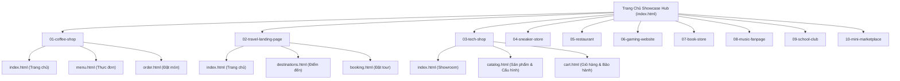

# 🏛️ KẾ HOẠCH TÁI CẤU TRÚC & NÂNG CẤP UI/UX: WEB BASIC SHOWCASE HUB
> **Cố vấn thiết kế:** Google Gemini (Argon Architecture)  
> **Tài liệu tham chiếu chuẩn mực:** `miqdadbadjuber/anti-slop` • `Nutlope/hallmark` • `nextlevelbuilder/ui-ux-pro-max-skill`  
> **Áp dụng cho:** Thư viện 10 Website Mẫu Sản Phẩm Cuối Khóa (SPCK) — MindX Web Basic  

---

## 1. PHÂN TÍCH HIỆN TRẠNG & TRIẾT LÝ THIẾT KẾ MỚI

### 1.1. Chẩn đoán các điểm nghẽn "AI Slop" trên giao diện cũ
Qua phản hồi thực tế và hình ảnh đối soát (nơi người dùng đã gạch chéo đỏ loại bỏ các thành phần rườm rà), giao diện cũ đang gặp 4 vấn đề lớn:
1. **Lạm dụng Dark Mode & Tím Neon rập khuôn:** Tông nền đen tím u tối (`#0b0f19` + gradient tím xanh) tạo cảm giác nặng nề, giống các template SaaS công nghiệp rẻ tiền hoặc trang crypto, không phù hợp với tính chất học liệu giáo dục sáng sủa, trực quan.
2. **Nhồi nhét khối văn bản học thuật (Information Overload):** Khối *"Kiến thức & Kỹ năng nổi bật"* với hàng loạt bullet points dài dòng khiến thẻ card cao lê thê. Học viên khi truy cập Hub muốn **nhìn thấy sản phẩm thật** chứ không muốn đọc lại đề cương môn học trên từng card.
3. **Rác thị giác từ Tag/Badge chằng chịt:** Dãy thẻ pill dày đặc (`HTML5 Semantic`, `Multi-Page`, `Pure CSS Modal`, `Form Order`...) làm phân tán sự tập trung và khiến bố cục bị băm vụn.
4. **Thiếu tính liên kết Đa Trang (Multi-Page):** Dù khóa học yêu cầu làm đồ án đa trang, các card cũ chỉ có một nút "Live Preview" chung chung dẫn về trang chủ, che giấu các trang con bên trong.

```
[ GIAO DIỆN CŨ: Nặng nề, rườm rà ]
┌──────────────────────────────────────┐
│  [Dark Banner] Cà Phê Mộc            │
│  Mô tả dài dòng 3-4 dòng...          │
│  ❌ $ KIẾN THỨC & KỸ NĂNG NỔI BẬT     │ <-- Đã gạch chéo đỏ bỏ
│     - Cấu trúc đa trang...           │
│     - Tương tác chọn Size...         │
│     - Modal xác nhận đơn...          │
│  ❌ [Tag 1] [Tag 2] [Tag 3] [Tag 4]   │ <-- Đã gạch chéo đỏ bỏ
│  [ Live Preview ]   [ Mở Tab Mới ]   │
└──────────────────────────────────────┘
                   ▼ CHUYỂN ĐỔI THÀNH
[ GIAO DIỆN MỚI: Tinh gọn, Daylight First ]
┌──────────────────────────────────────┐
│  • • •   01-coffee-shop/index.html   │ <-- Browser Frame thanh lịch
├──────────────────────────────────────┤
│                                      │
│     [ VISUAL MOCKUP GIAO DIỆN THẬT ] │ <-- Khung nhìn trực quan 16:10
│                                      │
├──────────────────────────────────────┤
│  #01 • ẨM THỰC & QUÁN CAFE           │ <-- Eyebrow gọn gàng
│  Cà Phê Mộc | Artisan Roastery       │ <-- Tiêu đề sắc nét
│  Cà phê rang mộc Tây Nguyên... (1 dòng)
│                                      │
│  3 TRANG: [Trang chủ] [Menu] [Đặt món]│ <-- Click chuyển trang tức thì!
│  [ Xem nhanh (3 trang) ]  [ Mở ↗ ]   │
└──────────────────────────────────────┘
```

---

### 1.2. Ba trụ cột thiết kế chuẩn mực áp dụng vào dự án

| Trụ cột tham chiếu | Nguyên tắc cốt lõi áp dụng vào Showcase Hub |
| :--- | :--- |
| **`miqdadbadjuber/anti-slop`** | • **Triệt tiêu 100%** khối text liệt kê kỹ năng và hàng loạt badge kỹ thuật thừa thãi.<br>• **Bỏ hoàn toàn** nền đen tím u tối và các dải gradient sến súa.<br>• **Quy tắc 1 dòng (Single-line constraint):** Tiêu đề 1 dòng, mô tả 1 dòng súc tích dưới 85 ký tự. |
| **`Nutlope/hallmark`** | • **Editorial Light Mode:** Nền sáng ấm (`#F8FAFC` / `#FFFFFF`), viền mảnh `1px solid #E2E8F0`, độ tương phản cao.<br>• **Intentional Typography:** Sử dụng font `Plus Jakarta Sans` kết hợp `JetBrains Mono` cho các nhãn chỉ số, tạo cảm giác như một ấn bản danh mục thiết kế chuyên nghiệp.<br>• **Browser Mockup Frame:** Biến ảnh minh họa thành một cửa sổ trình duyệt thu nhỏ với 3 chấm điều hướng tinh tế. |
| **`ui-ux-pro-max-skill`** | • **Visual-First Layout:** Người dùng nhìn thấy giao diện thật của bài làm trong vòng 3 giây đầu.<br>• **Quick Sub-page Navigation:** Tích hợp trực tiếp các nút chọn nhanh từng trang con (`Sub-page Pills`) ngay trên thẻ card và trong Modal xem trước.<br>• **Micro-interactions mượt mà:** Hiệu ứng hover nhấc card nhẹ (`translateY(-4px)`), phóng nhẹ ảnh mockup (`scale(1.03)`), không dùng glow bóng lộn xộn. |

---

## 2. QUY HOẠCH KIẾN TRÚC ĐA TRANG (MULTI-PAGE) CHO 10 ĐỀ TÀI CHUẨN MỰC

Toàn bộ **10 thư mục dự án mẫu** trong workspace được chuẩn hóa theo kiến trúc **Website Đa Trang hoàn chỉnh (mỗi đề tài tối thiểu 3 file `.html` độc lập)**. Tất cả các trang trong cùng một đề tài sử dụng chung 1 file `styles.css` và liên kết điều hướng thông suốt qua thanh menu `<nav>`.



---

### Bảng cấu trúc chi tiết 10 Đề tài:

#### 01. `01-coffee-shop` | Cà Phê Mộc — Artisan Roastery
* **Lĩnh vực:** F&B & Quán Cafe
* **Cấu trúc 3 trang:**
  1. `index.html` (**Trang chủ - Câu chuyện cà phê mộc**): Hero banner ấm cúng, nguồn gốc hạt Robusta Đắk Lắk & Arabica Cầu Đất, quy trình rang mộc thủ công, các góc không gian quán.
  2. `menu.html` (**Thực đơn chi tiết**): Phân loại thức uống (Espresso, Cold Brew, Trà ủ lạnh, Bánh thủ công) kèm mức giá và thẻ dinh dưỡng.
  3. `order.html` (**Đặt hàng online & Giao tận nơi**): Form tuỳ biến thức uống (chọn Size M/L, % Đường, % Đá), giỏ hàng tóm tắt hóa đơn và thông tin giao nhận.

#### 02. `02-travel-landing-page` | Explore Vietnam — Du Lịch Kỳ Thú
* **Lĩnh vực:** Du lịch & Khám phá
* **Cấu trúc 3 trang:**
  1. `index.html` (**Trang chủ - Cảm hứng dải đất hình chữ S**): Hero video/ảnh panorama, bản đồ du lịch 3 miền Bắc - Trung - Nam, số liệu thống kê du khách và cẩm nang du lịch.
  2. `destinations.html` (**Danh mục 6 Thắng cảnh trứ danh**): Thẻ điểm đến chi tiết (Hạ Long, Hội An, Phú Quốc, Sa Pa, Tràng An, Phong Nha) với mùa đẹp nhất và bảng giá tour tham khảo.
  3. `booking.html` (**Đăng ký & Tư vấn lịch trình**): Form chọn điểm đến, ngày khởi hành, số lượng người lớn/trẻ em, tiêu chuẩn khách sạn và câu hỏi hỗ trợ.

#### 03. `03-tech-shop` | TechZone — Siêu Thị Đồ Công Nghệ
* **Lĩnh vực:** Thương mại điện tử & Thiết bị số
* **Cấu trúc 3 trang:**
  1. `index.html` (**Showroom Trang chủ**): Banner ưu đãi Laptop AI thế hệ mới, 4 danh mục mũi nhọn (Laptop, Flagship Phone, Tai nghe ANC, Smartwatch), ưu đãi giờ vàng.
  2. `catalog.html` (**Danh mục & So sánh Cấu hình**): Bộ lọc sản phẩm theo mức giá/thương hiệu, bảng đối chiếu thông số kỹ thuật (Chipset, RAM, Pin, Màn hình OLED).
  3. `cart.html` (**Giỏ hàng & Tra cứu Bảo hành**): Bảng tóm tắt giỏ hàng, áp mã giảm giá voucher, form thanh toán trả góp 0% và ô tra cứu số serial bảo hành chính hãng.

#### 04. `04-sneaker-store` | Sneaker Store — Giày & Streetwear
* **Lĩnh vực:** Thời trang thể thao đường phố
* **Cấu trúc 3 trang:**
  1. `index.html` (**Trang chủ - Lookbook Streetwear**): Bộ sưu tập giày giới hạn hot trend, video nhịp sống đường phố, banner giảm giá bộ sưu tập mùa hè.
  2. `shop.html` (**Cửa hàng & Bảng chọn Size**): Danh sách mẫu giày (Jordan, Yeezy, Air Max), bộ lọc thương hiệu, bộ chọn Size giày tương tác (38 - 44).
  3. `checkout.html` (**Thanh toán & Xác nhận đơn**): Tóm tắt giỏ hàng, bảng quy đổi size chân chuẩn mm, biểu mẫu địa chỉ giao hàng và mã quà tặng.

#### 05. `05-restaurant` | Bếp Quê — Ẩm Thực Cơm Nhà Việt
* **Lĩnh vực:** Nhà hàng & Ẩm thực truyền thống
* **Cấu trúc 3 trang:**
  1. `index.html` (**Trang chủ - Hương vị quê nhà**): Câu chuyện gìn giữ ẩm thực gia đình 3 miền, không gian làng quê ấm cúng, lời chào từ bếp trưởng.
  2. `menu.html` (**Thực đơn Cơm Niêu & Món Ngon 3 Miền**): Menu chia theo Mâm cơm Bắc - Trung - Nam, món canh rau dân dã, món kho tộ, thức uống thanh nhiệt.
  3. `reservation.html` (**Đặt bàn giữ chỗ trực tuyến**): Form chọn ngày, khung giờ ăn (Trưa/Tối), số lượng khách (gia đình/tiệc công ty), chọn phòng riêng và ghi chú dị ứng món ăn.

#### 06. `06-gaming-website` | Cyber Quest 2099 — Sci-Fi Gaming Hub
* **Lĩnh vực:** Game & Công nghệ tương lai
* **Cấu trúc 3 trang:**
  1. `index.html` (**Trang chủ - Trailer & Bối cảnh cốt truyện**): Đoạn teaser bối cảnh thế giới tương lai năm 2099, điểm đánh giá của các tạp chí game, nút tải bản chơi thử.
  2. `characters.html` (**Hệ thống Nhân vật & Kho Vũ khí**): Bảng chỉ số sức mạnh từng class (Hacker, Cyborg, Assassin), mô hình trang bị vũ khí công nghệ cao.
  3. `download.html` (**Cấu hình PC & Đăng ký trải nghiệm**): Bảng đối chiếu cấu hình tối thiểu/đề nghị (CPU, GPU, RAM, SSD), form nhận mã code Closed Beta và link tải bộ cài đặt.

#### 07. `07-book-store` | Tri Thức Bookstore — Hiệu Sách & Văn Hóa Đọc
* **Lĩnh vực:** Sách, Tri thức & Giáo dục
* **Cấu trúc 3 trang:**
  1. `index.html` (**Trang chủ - Không gian văn hóa đọc**): Tác phẩm bán chạy trong tuần, danh ngôn về sách, giới thiệu góc đọc sách yên tĩnh tại hiệu sách.
  2. `catalog.html` (**Tủ sách theo chủ đề**): Danh mục phân loại (Kinh tế khởi nghiệp, Kỹ năng sống, Văn học cổ điển, Khoa học công nghệ) kèm bộ lọc giá và định dạng (Bìa mềm/Bìa cứng/Ebook).
  3. `detail.html` (**Trang chi tiết sách & Đọc thử**): Tóm tắt nội dung tác phẩm, trích dẫn đoạn văn hay, đánh giá độc giả 5 sao và biểu mẫu đặt mua giao tận nhà.

#### 08. `08-music-fanpage` | Acoustic Soul — Ban Nhạc & Fanpage Âm Nhạc
* **Lĩnh vực:** Giải trí & Âm nhạc Indie
* **Cấu trúc 3 trang:**
  1. `index.html` (**Trang chủ - Giai điệu mộc mạc**): Giới thiệu các thành viên trong ban nhạc, thông điệp âm nhạc acoustic thuần khiết, gallery hình ảnh biểu diễn tại quán cafe/phòng trà.
  2. `music.html` (**Kho nhạc & Danh sách bài hát**): Giao diện giả lập Music Player (Pure CSS), danh sách album phát hành, lời bài hát (Lyrics) và hợp âm guitar cơ bản.
  3. `contact.html` (**Lịch biểu diễn & Đặt vé Live show**): Bảng lịch trình biểu diễn tour cuối tuần, form đặt vé giữ chỗ tại đêm nhạc và liên hệ booking sự kiện.

#### 09. `09-school-club` | MindX Coding Club — CLB Lập Trình Học Đường
* **Lĩnh vực:** Câu lạc bộ & Hoạt động sinh viên
* **Cấu trúc 3 trang:**
  1. `index.html` (**Trang chủ - Sứ mệnh & Tinh thần đồng đội**): Tôn chỉ hoạt động của CLB, lộ trình phát triển kỹ năng lập trình (Web, Python, Game), hình ảnh sinh hoạt định kỳ.
  2. `projects.html` (**Showcase Đồ án Thành viên**): Triển lãm các sản phẩm công nghệ do thành viên CLB tự tay code, bảng vinh danh thành viên xuất sắc của tháng.
  3. `register.html` (**Biểu mẫu Ứng tuyển thành viên**): Form tuyển sinh mùa mới, chọn ban chuyên môn (Ban Kỹ thuật Code, Ban Thiết kế UI/UX, Ban Truyền thông), câu hỏi trắc nghiệm sở thích.

#### 10. `10-mini-marketplace` | Mini Market — Siêu Thị Nông Sản Tiện Lợi
* **Lĩnh vực:** Chợ nông sản sạch & Nhu yếu phẩm
* **Cấu trúc 3 trang:**
  1. `index.html` (**Trang chủ - Nông sản sạch mỗi ngày**): Cam kết tiêu chuẩn VietGAP, rau củ tươi nhập mới 5h sáng, chương trình tích điểm khách hàng thân thiết.
  2. `products.html` (**Gian hàng Rau củ quả & Trái cây**): Lưới sản phẩm trực quan có đơn vị tính rõ ràng (theo kg/hộp/bó), nút thêm vào giỏ hàng và huy hiệu hữu cơ.
  3. `checkout.html` (**Giỏ hàng & Đặt giao nhanh 30 phút**): Bảng kiểm tra đơn hàng, chọn khung giờ nhận hàng (Sáng/Chiều), địa chỉ nhận hàng và chính sách đổi trả 1-đổi-1 nếu dập nát.

---

## 3. THIẾT KẾ GIẢI PHẪU THẺ DỰ ÁN MỚI (CARD ANATOMY)

Mỗi thẻ dự án trên trang chủ Hub sẽ áp dụng thiết kế **Editorial Browser Window**, loại bỏ hoàn toàn các khối chữ rác, chỉ giữ lại các thành phần trực quan đắt giá:

```
+─────────────────────────────────────────────────────────────+
│  (•) (•) (•)   📁 01-coffee-shop/index.html            ↗    │ <-- 1. Browser Toolbar
+─────────────────────────────────────────────────────────────+
│                                                             │
│                    [ HÌNH ẢNH MOCKUP 16:10 ]                │ <-- 2. Visual Viewport
│                 (Ảnh giao diện thật, không đè chữ)          │
│                                                             │
+─────────────────────────────────────────────────────────────+
│  #01 • ẨM THỰC & QUÁN CAFE                                  │ <-- 3. Eyebrow Category
│  Cà Phê Mộc | Artisan Roastery                              │ <-- 4. Main Project Title
│  Không gian thưởng thức và đặt cà phê rang mộc nguyên chất. │ <-- 5. 1-Line Description
│                                                             │
│  3 TRANG:  [ Trang chủ ]  [ Thực đơn ]  [ Đặt món ]         │ <-- 6. Quick Page Switcher
│                                                             │
│  +──────────────────────────────+  +─────────────────────+  │
│  |      Live Preview (3 trang)  |  |      Mở tab mới ↗   |  │ <-- 7. Primary Actions
│  +──────────────────────────────+  +─────────────────────+  │
+─────────────────────────────────────────────────────────────+
```

### Các quy tắc kiểm soát Slop trên thẻ Card:
1. **Không có gạch đầu dòng liệt kê:** Cắt bỏ 100% mục *"Kiến thức & Kỹ năng nổi bật"*.
2. **Không có cụm tag kỹ thuật vô nghĩa:** Bỏ toàn bộ tag `HTML5 Semantic`, `Flexbox`, `CSS Variables` ở chân thẻ.
3. **Mô tả dự án chuẩn 1 dòng:** Áp dụng `white-space: nowrap; overflow: hidden; text-overflow: ellipsis;` để card luôn giữ chiều cao đồng đều tuyệt đối trên mọi màn hình.
4. **Sub-page Quick Pills:** Bấm vào bất kỳ trang con nào trên card (`[Trang chủ]`, `[Thực đơn]`, `[Đặt món]`) sẽ mở ngay Modal xem trước chính xác trang con đó mà không cần qua trang trung gian.

---

## 4. BỘ CODE TINH GỌN HOÀN CHỈNH CHO TRANG CHỦ HUB

Hệ thống code được viết **100% bằng HTML5, CSS3 hiện đại (CSS Variables, Flexbox, Grid) và Vanilla JavaScript sạch sẽ**, không phụ thuộc Tailwind hay bất kỳ thư viện ngoài nào, đúng với tôn chỉ môn Web Basic.

### 4.1. File `index.html` (Trang chủ Hub chuẩn mực)

```html
<!DOCTYPE html>
<html lang="vi">
<head>
  <meta charset="UTF-8">
  <meta name="viewport" content="width=device-width, initial-scale=1.0">
  <title>MindX Web Basic | Bộ Sưu Tập 10 Website Mẫu SPCK</title>
  <meta name="description" content="Cổng tổng hợp 10 website mẫu Sản Phẩm Cuối Khóa chuẩn mực, sáng sủa, kiến trúc đa trang 100% HTML5 & CSS3 thuần.">

  <!-- Favicon -->
  <link rel="icon" href="data:image/svg+xml,<svg xmlns=%22http://www.w3.org/2000/svg%22 viewBox=%220 0 100 100%22><text y=%22.9em%22 font-size=%2290%22>🚀</text></svg>">

  <!-- Google Fonts: Plus Jakarta Sans & JetBrains Mono -->
  <link rel="preconnect" href="https://fonts.googleapis.com">
  <link rel="preconnect" href="https://fonts.gstatic.com" crossorigin>
  <link href="https://fonts.googleapis.com/css2?family=JetBrains+Mono:wght@400;500;600&family=Plus+Jakarta+Sans:wght@400;500;600;700&display=swap" rel="stylesheet">

  <link rel="stylesheet" href="hub-style.css">
</head>
<body>

  <!-- 1. HEADER EDITORIAL -->
  <header class="hub-header">
    <div class="container header-inner">
      <a href="index.html" class="hub-brand">
        <span class="brand-badge-icon">🚀</span>
        <div class="brand-text">
          <span class="brand-title">SPCK Showcase</span>
          <span class="brand-sub">MindX Web Basic Directory</span>
        </div>
      </a>

      <div class="header-stats">
        <span class="stat-pill"><strong>10</strong> Đề Tài Mẫu</span>
        <span class="stat-divider">/</span>
        <span class="stat-pill"><strong>30+</strong> Trang Giao Diện</span>
        <span class="stat-divider">/</span>
        <span class="stat-pill"><strong>100%</strong> HTML5 & CSS3</span>
      </div>
    </div>
  </header>

  <!-- 2. HERO SECTION TINH GỌN (Ít chữ, sáng sủa, đi thẳng vào sản phẩm) -->
  <section class="hub-hero">
    <div class="container hero-inner">
      <span class="hero-eyebrow">BỘ SƯU TẬP ĐỒ ÁN MẪU CHUẨN MỰC</span>
      <h1 class="hero-title">Thiết Kế Có Chủ Đích.<br>Kiến Trúc Đa Trang Hoàn Chỉnh.</h1>
      <p class="hero-desc">
        Tuyển tập 10 website thực tế được chuẩn hóa với giao diện sáng sủa, thoáng đãng, 
        mỗi đề tài sở hữu tối thiểu 3 trang giao diện độc lập kết nối liền mạch.
      </p>

      <!-- Thanh Tìm Kiếm Trực Tiếp -->
      <div class="search-bar-wrap">
        <span class="search-icon">🔍</span>
        <input 
          type="text" 
          id="searchInput" 
          class="search-input" 
          placeholder="Tìm theo tên đề tài, lĩnh vực hoặc trang con (VD: coffee, tour, laptop, shoe...)"
          autocomplete="off"
        >
        <button id="searchClear" class="search-clear" title="Xóa tìm kiếm">✕</button>
      </div>

      <!-- Bộ Lọc Danh Mục Tối Giản -->
      <div class="filter-tabs" id="filterContainer">
        <button class="filter-tab active" data-filter="all">Tất Cả (10)</button>
        <button class="filter-tab" data-filter="fnb">☕ Ẩm Thực & F&B</button>
        <button class="filter-tab" data-filter="ecommerce">🛒 Thương Mại Điện Tử</button>
        <button class="filter-tab" data-filter="service">✈️ Du Lịch & Dịch Vụ</button>
        <button class="filter-tab" data-filter="community">🎮 Giải Trí & Cộng Đồng</button>
      </div>
    </div>
  </section>

  <!-- 3. LƯỚI THẺ DỰ ÁN TINH GỌN -->
  <main class="container">
    <div class="results-header">
      <span id="resultsCount" class="results-count">Hiển thị 10 / 10 đề tài</span>
    </div>
    <div class="showcase-grid" id="projectsContainer">
      <!-- Tự động nạp từ hub-script.js -->
    </div>
  </main>

  <!-- 4. MODAL LIVE PREVIEW ĐA TRANG (Interactive Device Frame) -->
  <div class="preview-modal" id="previewModal" aria-hidden="true">
    <div class="modal-overlay" id="modalOverlay"></div>
    <div class="modal-box">
      <!-- Toolbar Modal -->
      <div class="modal-bar">
        <div class="modal-bar-left">
          <div class="browser-dots">
            <span class="dot dot-red"></span>
            <span class="dot dot-yellow"></span>
            <span class="dot dot-green"></span>
          </div>
          <span class="modal-title" id="modalProjectTitle">Tên Đề Tài</span>
        </div>

        <!-- Trình chuyển đổi 3 trang con ngay trong Modal -->
        <div class="modal-tabs" id="modalSubPagesTabs"></div>

        <div class="modal-bar-right">
          <a href="#" target="_blank" rel="noopener" class="btn-external" id="modalExternalBtn" title="Mở trang trong tab trình duyệt mới">
            Mở Tab Mới ↗
          </a>
          <button class="btn-close-modal" id="modalCloseBtn" aria-label="Đóng modal">✕</button>
        </div>
      </div>

      <!-- Viewport Iframe xem trực tiếp -->
      <div class="modal-viewport">
        <iframe id="previewIframe" src="about:blank" title="Live Preview"></iframe>
      </div>
    </div>
  </div>

  <!-- 5. CHÂN TRANG TỐI GIẢN -->
  <footer class="hub-footer">
    <div class="container footer-inner">
      <p>© 2026 MindX Web Basic. Thiết kế theo tiêu chuẩn Anti-Slop, Daylight First & Intentional Design.</p>
      <p>100% Thuần HTML5 & CSS3 — Không phụ thuộc framework.</p>
    </div>
  </footer>

  <script src="hub-script.js"></script>
</body>
</html>
```

---

### 4.2. File `hub-style.css` (Daylight First, Editorial & Anti-Slop)

```css
/* ==========================================================================
   MINDX WEB BASIC SHOWCASE - DAYLIGHT FIRST DESIGN SYSTEM
   Anti-Slop • Hallmark Editorial • UI-UX-Pro-Max Guidelines
   ========================================================================== */

:root {
  /* Bảng màu sáng sủa (Daylight Canvas) */
  --bg-canvas: #f8fafc;
  --bg-card: #ffffff;
  --bg-subtle: #f1f5f9;
  --bg-muted: #e2e8f0;

  /* Màu chữ phân cấp độ tương phản cao */
  --text-main: #0f172a;
  --text-secondary: #475569;
  --text-muted: #64748b;

  /* Đường viền mỏng thanh lịch */
  --border-light: #e2e8f0;
  --border-hover: #cbd5e1;

  /* Điểm nhấn thương hiệu */
  --accent: #2563eb;
  --accent-hover: #1d4ed8;
  --accent-light: #eff6ff;

  /* Bo góc & Đổ bóng tinh tế */
  --radius-lg: 16px;
  --radius-md: 10px;
  --radius-sm: 6px;
  --shadow-card: 0 1px 3px rgba(15, 23, 42, 0.04), 0 1px 2px rgba(15, 23, 42, 0.02);
  --shadow-hover: 0 14px 28px -6px rgba(15, 23, 42, 0.08), 0 6px 12px -4px rgba(15, 23, 42, 0.04);

  /* Phông chữ */
  --font-sans: 'Plus Jakarta Sans', -apple-system, BlinkMacSystemFont, sans-serif;
  --font-mono: 'JetBrains Mono', monospace;
}

* {
  box-sizing: border-box;
  margin: 0;
  padding: 0;
}

body {
  background-color: var(--bg-canvas);
  color: var(--text-main);
  font-family: var(--font-sans);
  line-height: 1.5;
  -webkit-font-smoothing: antialiased;
}

.container {
  max-width: 1260px;
  margin: 0 auto;
  padding: 0 24px;
}

/* 1. HEADER */
.hub-header {
  background: rgba(255, 255, 255, 0.85);
  backdrop-filter: blur(12px);
  border-bottom: 1px solid var(--border-light);
  position: sticky;
  top: 0;
  z-index: 50;
}

.header-inner {
  height: 68px;
  display: flex;
  align-items: center;
  justify-content: space-between;
}

.hub-brand {
  display: flex;
  align-items: center;
  gap: 12px;
  text-decoration: none;
}

.brand-badge-icon {
  font-size: 1.5rem;
}

.brand-title {
  display: block;
  font-size: 1.05rem;
  font-weight: 700;
  color: var(--text-main);
  letter-spacing: -0.02em;
}

.brand-sub {
  display: block;
  font-size: 0.75rem;
  color: var(--text-muted);
}

.header-stats {
  display: flex;
  align-items: center;
  gap: 10px;
  font-size: 0.82rem;
  color: var(--text-secondary);
}

.stat-pill strong {
  color: var(--accent);
}

.stat-divider {
  color: var(--border-light);
}

/* 2. HERO SECTION */
.hub-hero {
  padding: 56px 0 40px;
  background: var(--bg-card);
  border-bottom: 1px solid var(--border-light);
  margin-bottom: 40px;
  text-align: center;
}

.hero-inner {
  max-width: 760px;
  margin: 0 auto;
}

.hero-eyebrow {
  display: inline-block;
  font-family: var(--font-mono);
  font-size: 0.72rem;
  font-weight: 600;
  color: var(--accent);
  background: var(--accent-light);
  padding: 4px 12px;
  border-radius: 999px;
  margin-bottom: 16px;
  letter-spacing: 0.05em;
}

.hero-title {
  font-size: clamp(2rem, 3.8vw, 2.8rem);
  font-weight: 800;
  color: var(--text-main);
  line-height: 1.18;
  letter-spacing: -0.03em;
  margin-bottom: 14px;
}

.hero-desc {
  font-size: 1.05rem;
  color: var(--text-secondary);
  line-height: 1.6;
  margin-bottom: 28px;
}

/* Live Search Bar */
.search-bar-wrap {
  position: relative;
  max-width: 580px;
  margin: 0 auto 24px;
}

.search-icon {
  position: absolute;
  left: 16px;
  top: 50%;
  transform: translateY(-50%);
  font-size: 0.95rem;
  color: var(--text-muted);
}

.search-input {
  width: 100%;
  padding: 13px 44px 13px 44px;
  background: var(--bg-canvas);
  border: 1px solid var(--border-light);
  border-radius: var(--radius-md);
  font-family: var(--font-sans);
  font-size: 0.92rem;
  color: var(--text-main);
  outline: none;
  transition: all 0.2s ease;
}

.search-input:focus {
  background: var(--bg-card);
  border-color: var(--accent);
  box-shadow: 0 0 0 3px rgba(37, 99, 235, 0.12);
}

.search-clear {
  position: absolute;
  right: 14px;
  top: 50%;
  transform: translateY(-50%);
  background: none;
  border: none;
  color: var(--text-muted);
  cursor: pointer;
  font-size: 0.85rem;
  display: none;
}

/* Category Filter Tabs */
.filter-tabs {
  display: flex;
  flex-wrap: wrap;
  justify-content: center;
  gap: 8px;
}

.filter-tab {
  background: var(--bg-canvas);
  border: 1px solid var(--border-light);
  color: var(--text-secondary);
  font-family: var(--font-sans);
  font-size: 0.85rem;
  font-weight: 600;
  padding: 8px 16px;
  border-radius: 999px;
  cursor: pointer;
  transition: all 0.2s ease;
}

.filter-tab:hover {
  border-color: var(--border-hover);
  color: var(--text-main);
}

.filter-tab.active {
  background: var(--text-main);
  border-color: var(--text-main);
  color: #ffffff;
}

/* 3. SHOWCASE GRID & CARD */
.results-header {
  display: flex;
  justify-content: space-between;
  align-items: center;
  margin-bottom: 24px;
}

.results-count {
  font-size: 0.85rem;
  color: var(--text-muted);
  font-weight: 500;
}

.showcase-grid {
  display: grid;
  grid-template-columns: repeat(auto-fill, minmax(360px, 1fr));
  gap: 28px;
  margin-bottom: 80px;
}

.project-card {
  background: var(--bg-card);
  border: 1px solid var(--border-light);
  border-radius: var(--radius-lg);
  overflow: hidden;
  box-shadow: var(--shadow-card);
  display: flex;
  flex-direction: column;
  transition: transform 0.25s cubic-bezier(0.16, 1, 0.3, 1),
              box-shadow 0.25s cubic-bezier(0.16, 1, 0.3, 1),
              border-color 0.2s ease;
}

.project-card:hover {
  transform: translateY(-4px);
  box-shadow: var(--shadow-hover);
  border-color: var(--border-hover);
}

/* Browser Mockup Header */
.card-browser-bar {
  height: 36px;
  background: var(--bg-subtle);
  border-bottom: 1px solid var(--border-light);
  padding: 0 14px;
  display: flex;
  align-items: center;
  justify-content: space-between;
}

.browser-dots {
  display: flex;
  gap: 6px;
}

.dot {
  width: 9px;
  height: 9px;
  border-radius: 50%;
}

.dot-red { background: #f87171; }
.dot-yellow { background: #fbbf24; }
.dot-green { background: #4ade80; }

.browser-path {
  font-family: var(--font-mono);
  font-size: 0.72rem;
  color: var(--text-muted);
}

/* 16:10 Visual Preview Container */
.card-visual {
  aspect-ratio: 16 / 10;
  background: var(--bg-subtle);
  border-bottom: 1px solid var(--border-light);
  overflow: hidden;
  position: relative;
  cursor: pointer;
  display: flex;
  align-items: center;
  justify-content: center;
}

.card-visual-banner {
  width: 100%;
  height: 100%;
  display: flex;
  flex-direction: column;
  align-items: center;
  justify-content: center;
  gap: 8px;
  transition: transform 0.35s ease;
}

.project-card:hover .card-visual-banner {
  transform: scale(1.03);
}

.visual-icon {
  font-size: 2.8rem;
}

.visual-hint {
  font-size: 0.75rem;
  font-weight: 600;
  color: var(--text-muted);
  background: rgba(255, 255, 255, 0.85);
  padding: 3px 10px;
  border-radius: 999px;
  border: 1px solid var(--border-light);
}

/* Card Body */
.card-body {
  padding: 20px 22px 22px;
  display: flex;
  flex-direction: column;
  flex-grow: 1;
}

.card-eyebrow {
  display: flex;
  align-items: center;
  gap: 8px;
  font-family: var(--font-mono);
  font-size: 0.72rem;
  color: var(--text-muted);
  margin-bottom: 8px;
  text-transform: uppercase;
}

.card-num {
  color: var(--accent);
  font-weight: 600;
}

.card-title {
  font-size: 1.15rem;
  font-weight: 700;
  color: var(--text-main);
  letter-spacing: -0.02em;
  margin-bottom: 6px;
}

/* Đúng 1 dòng duy nhất - Không tràn chữ */
.card-desc {
  font-size: 0.88rem;
  color: var(--text-secondary);
  white-space: nowrap;
  overflow: hidden;
  text-overflow: ellipsis;
  margin-bottom: 16px;
}

/* Sub-page Quick Switcher Pills */
.card-pages {
  display: flex;
  align-items: center;
  gap: 6px;
  flex-wrap: wrap;
  padding: 12px 0;
  border-top: 1px solid var(--bg-subtle);
  margin-top: auto;
  margin-bottom: 16px;
}

.pages-label {
  font-family: var(--font-mono);
  font-size: 0.68rem;
  color: var(--text-muted);
  font-weight: 600;
  margin-right: 2px;
}

.page-pill {
  background: var(--bg-canvas);
  border: 1px solid var(--border-light);
  color: var(--text-secondary);
  font-family: var(--font-sans);
  font-size: 0.74rem;
  font-weight: 500;
  padding: 3px 9px;
  border-radius: var(--radius-sm);
  cursor: pointer;
  transition: all 0.15s ease;
}

.page-pill:hover {
  background: var(--accent-light);
  border-color: #bfdbfe;
  color: var(--accent);
}

/* Action Buttons */
.card-actions {
  display: grid;
  grid-template-columns: 1fr auto;
  gap: 10px;
}

.btn-preview {
  background: var(--text-main);
  color: #ffffff;
  border: none;
  padding: 10px 16px;
  border-radius: var(--radius-md);
  font-family: var(--font-sans);
  font-size: 0.85rem;
  font-weight: 600;
  cursor: pointer;
  transition: background 0.2s ease;
}

.btn-preview:hover {
  background: #1e293b;
}

.btn-newtab {
  background: var(--bg-card);
  color: var(--text-main);
  border: 1px solid var(--border-light);
  padding: 10px 14px;
  border-radius: var(--radius-md);
  font-size: 0.85rem;
  font-weight: 600;
  text-decoration: none;
  display: inline-flex;
  align-items: center;
  justify-content: center;
  transition: all 0.2s ease;
}

.btn-newtab:hover {
  background: var(--bg-subtle);
  border-color: var(--border-hover);
}

/* 4. LIVE PREVIEW MODAL */
.preview-modal {
  position: fixed;
  inset: 0;
  z-index: 100;
  display: none;
  align-items: center;
  justify-content: center;
  padding: 24px;
}

.preview-modal.is-open {
  display: flex;
}

.modal-overlay {
  position: absolute;
  inset: 0;
  background: rgba(15, 23, 42, 0.45);
  backdrop-filter: blur(6px);
}

.modal-box {
  position: relative;
  width: 100%;
  max-width: 1320px;
  height: 90vh;
  background: var(--bg-card);
  border-radius: var(--radius-lg);
  border: 1px solid var(--border-light);
  display: flex;
  flex-direction: column;
  overflow: hidden;
  box-shadow: 0 25px 50px -12px rgba(15, 23, 42, 0.25);
}

.modal-bar {
  height: 54px;
  background: var(--bg-subtle);
  border-bottom: 1px solid var(--border-light);
  padding: 0 18px;
  display: flex;
  align-items: center;
  justify-content: space-between;
  gap: 16px;
}

.modal-bar-left {
  display: flex;
  align-items: center;
  gap: 12px;
}

.modal-title {
  font-size: 0.9rem;
  font-weight: 700;
}

.modal-tabs {
  display: flex;
  gap: 6px;
  background: var(--bg-muted);
  padding: 4px;
  border-radius: var(--radius-md);
}

.modal-tab-btn {
  border: none;
  background: transparent;
  padding: 5px 12px;
  border-radius: 6px;
  font-family: var(--font-sans);
  font-size: 0.78rem;
  font-weight: 600;
  color: var(--text-secondary);
  cursor: pointer;
  transition: all 0.15s ease;
}

.modal-tab-btn.active {
  background: var(--bg-card);
  color: var(--text-main);
  box-shadow: 0 1px 2px rgba(0, 0, 0, 0.06);
}

.modal-bar-right {
  display: flex;
  align-items: center;
  gap: 10px;
}

.btn-external {
  font-size: 0.8rem;
  font-weight: 600;
  color: var(--accent);
  text-decoration: none;
  padding: 6px 10px;
}

.btn-close-modal {
  width: 32px;
  height: 32px;
  border: 1px solid var(--border-light);
  background: var(--bg-card);
  border-radius: 6px;
  cursor: pointer;
  font-size: 0.9rem;
}

.modal-viewport {
  flex-grow: 1;
  background: #ffffff;
}

.modal-viewport iframe {
  width: 100%;
  height: 100%;
  border: none;
}

/* 5. FOOTER */
.hub-footer {
  border-top: 1px solid var(--border-light);
  padding: 32px 0;
  background: var(--bg-card);
  color: var(--text-muted);
  font-size: 0.85rem;
  text-align: center;
}

.footer-inner {
  display: flex;
  flex-direction: column;
  gap: 6px;
}

@media (max-width: 768px) {
  .header-stats { display: none; }
  .showcase-grid { grid-template-columns: 1fr; }
  .modal-tabs { overflow-x: auto; max-width: 50%; }
}
```

---

### 4.3. File `hub-script.js` (Quản lý 10 Đề tài & Tương tác Đa Trang)

```javascript
/**
 * MINDX WEB BASIC - SHOWCASE HUB CONTROLLER
 * Quản lý dữ liệu 10 Đề tài SPCK chuẩn 3 trang, bộ lọc, tìm kiếm và Live Preview
 */

const SPCK_PROJECTS = [
  {
    id: "01",
    folder: "01-coffee-shop",
    category: "fnb",
    categoryLabel: "Ẩm thực & Quán Cafe",
    title: "Cà Phê Mộc | Artisan Roastery",
    desc: "Cà phê rang mộc nguyên chất Tây Nguyên, menu đa dạng và đặt món online.",
    icon: "☕",
    bgPattern: "linear-gradient(135deg, #fef3c7 0%, #fde68a 100%)",
    subPages: [
      { name: "Trang chủ", file: "index.html" },
      { name: "Thực đơn", file: "menu.html" },
      { name: "Đặt món", file: "order.html" }
    ]
  },
  {
    id: "02",
    folder: "02-travel-landing-page",
    category: "service",
    categoryLabel: "Du lịch & Khám phá",
    title: "Explore Vietnam | Du Lịch Kỳ Thú",
    desc: "Khám phá 6 thắng cảnh di sản Việt Nam kèm lịch trình 3N2Đ và đặt tour.",
    icon: "✈️",
    bgPattern: "linear-gradient(135deg, #cffafe 0%, #a5f3fc 100%)",
    subPages: [
      { name: "Trang chủ", file: "index.html" },
      { name: "Điểm đến", file: "destinations.html" },
      { name: "Đặt tour", file: "booking.html" }
    ]
  },
  {
    id: "03",
    folder: "03-tech-shop",
    category: "ecommerce",
    categoryLabel: "Thương mại điện tử",
    title: "TechZone | Siêu Thị Đồ Công Nghệ",
    desc: "Showroom thiết bị số, laptop AI thế hệ mới, so sánh thông số và giỏ hàng.",
    icon: "💻",
    bgPattern: "linear-gradient(135deg, #dbeafe 0%, #bfdbfe 100%)",
    subPages: [
      { name: "Showroom", file: "index.html" },
      { name: "Cấu hình", file: "catalog.html" },
      { name: "Giỏ hàng", file: "cart.html" }
    ]
  },
  {
    id: "04",
    folder: "04-sneaker-store",
    category: "ecommerce",
    categoryLabel: "Thời trang & Giày",
    title: "Sneaker Store | Giày & Streetwear",
    desc: "Thời trang sneaker đường phố, bộ chọn size giày tương tác và thanh toán.",
    icon: "👟",
    bgPattern: "linear-gradient(135deg, #ffedd5 0%, #fed7aa 100%)",
    subPages: [
      { name: "Trang chủ", file: "index.html" },
      { name: "Cửa hàng", file: "shop.html" },
      { name: "Thanh toán", file: "checkout.html" }
    ]
  },
  {
    id: "05",
    folder: "05-restaurant",
    category: "fnb",
    categoryLabel: "Ẩm thực & Nhà hàng",
    title: "Bếp Quê | Ẩm Thực Cơm Nhà Việt",
    desc: "Hương vị ẩm thực cơm quê 3 miền, thực đơn phong phú và đặt bàn ăn online.",
    icon: "🍲",
    bgPattern: "linear-gradient(135deg, #fef9c3 0%, #fef08a 100%)",
    subPages: [
      { name: "Trang chủ", file: "index.html" },
      { name: "Thực đơn", file: "menu.html" },
      { name: "Đặt bàn", file: "reservation.html" }
    ]
  },
  {
    id: "06",
    folder: "06-gaming-website",
    category: "community",
    categoryLabel: "Game & Công nghệ",
    title: "Cyber Quest 2099 | Game Sci-Fi",
    desc: "Bối cảnh game viễn tưởng tương lai, hồ sơ nhân vật và bảng cấu hình PC.",
    icon: "🎮",
    bgPattern: "linear-gradient(135deg, #ede9fe 0%, #ddd6fe 100%)",
    subPages: [
      { name: "Trang chủ", file: "index.html" },
      { name: "Nhân vật", file: "characters.html" },
      { name: "Tải game", file: "download.html" }
    ]
  },
  {
    id: "07",
    folder: "07-book-store",
    category: "community",
    categoryLabel: "Sách & Tri thức",
    title: "Tri Thức | Hiệu Sách & Văn Hóa Đọc",
    desc: "Tủ sách tinh hoa theo chuyên mục, trích dẫn truyền cảm hứng và đọc thử.",
    icon: "📚",
    bgPattern: "linear-gradient(135deg, #fae8ff 0%, #f5d0fe 100%)",
    subPages: [
      { name: "Trang chủ", file: "index.html" },
      { name: "Tủ sách", file: "catalog.html" },
      { name: "Đọc thử", file: "detail.html" }
    ]
  },
  {
    id: "08",
    folder: "08-music-fanpage",
    category: "community",
    categoryLabel: "Âm nhạc & Nghệ thuật",
    title: "Acoustic Soul | Ban Nhạc & Fanpage",
    desc: "Ban nhạc indie acoustic, trình nghe nhạc trực tuyến và lịch lưu diễn.",
    icon: "🎸",
    bgPattern: "linear-gradient(135deg, #ffe4e6 0%, #fecdd3 100%)",
    subPages: [
      { name: "Trang chủ", file: "index.html" },
      { name: "Kho nhạc", file: "music.html" },
      { name: "Đặt vé", file: "contact.html" }
    ]
  },
  {
    id: "09",
    folder: "09-school-club",
    category: "community",
    categoryLabel: "CLB & Học đường",
    title: "MindX Coding Club | CLB Lập Trình",
    desc: "Hoạt động câu lạc bộ công nghệ, triển lãm đồ án và đơn ứng tuyển thành viên.",
    icon: "🚀",
    bgPattern: "linear-gradient(135deg, #e0e7ff 0%, #c7d2fe 100%)",
    subPages: [
      { name: "Trang chủ", file: "index.html" },
      { name: "Dự án", file: "projects.html" },
      { name: "Ứng tuyển", file: "register.html" }
    ]
  },
  {
    id: "10",
    folder: "10-mini-marketplace",
    category: "ecommerce",
    categoryLabel: "Nông sản & Tiện lợi",
    title: "Mini Market | Nông Sản Tiện Lợi",
    desc: "Thực phẩm tươi sạch chuẩn VietGAP, mua theo kg và giao hàng siêu tốc 30p.",
    icon: "🥦",
    bgPattern: "linear-gradient(135deg, #dcfce7 0%, #bbf7d0 100%)",
    subPages: [
      { name: "Trang chủ", file: "index.html" },
      { name: "Nông sản", file: "products.html" },
      { name: "Giao hàng", file: "checkout.html" }
    ]
  }
];

// Trạng thái bộ lọc
let currentCategory = "all";
let currentSearch = "";
let currentActiveProject = null;

// DOM Elements
const projectsContainer = document.getElementById("projectsContainer");
const resultsCountEl = document.getElementById("resultsCount");
const searchInput = document.getElementById("searchInput");
const searchClearBtn = document.getElementById("searchClear");
const filterTabs = document.querySelectorAll(".filter-tab");

// Modal Elements
const previewModal = document.getElementById("previewModal");
const modalOverlay = document.getElementById("modalOverlay");
const modalCloseBtn = document.getElementById("modalCloseBtn");
const modalProjectTitle = document.getElementById("modalProjectTitle");
const modalSubPagesTabs = document.getElementById("modalSubPagesTabs");
const modalExternalBtn = document.getElementById("modalExternalBtn");
const previewIframe = document.getElementById("previewIframe");

/**
 * 1. Render danh sách 10 thẻ dự án tinh gọn
 */
function renderProjects() {
  const filtered = SPCK_PROJECTS.filter(project => {
    const matchCat = currentCategory === "all" || project.category === currentCategory;
    const query = currentSearch.toLowerCase().trim();
    const matchSearch = !query || (
      project.title.toLowerCase().includes(query) ||
      project.desc.toLowerCase().includes(query) ||
      project.folder.toLowerCase().includes(query) ||
      project.subPages.some(sp => sp.name.toLowerCase().includes(query) || sp.file.toLowerCase().includes(query))
    );
    return matchCat && matchSearch;
  });

  resultsCountEl.textContent = `Hiển thị ${filtered.length} / ${SPCK_PROJECTS.length} đề tài`;

  if (filtered.length === 0) {
    projectsContainer.innerHTML = `
      <div style="grid-column: 1 / -1; text-align: center; padding: 60px 20px;">
        <div style="font-size: 2.5rem; margin-bottom: 12px;">🔍</div>
        <h3 style="font-size: 1.2rem; font-weight: 700; margin-bottom: 6px;">Không tìm thấy đề tài phù hợp</h3>
        <p style="color: var(--text-muted); font-size: 0.9rem;">Vui lòng thử từ khóa khác hoặc chọn danh mục "Tất Cả".</p>
      </div>
    `;
    return;
  }

  projectsContainer.innerHTML = filtered.map(project => {
    const defaultUrl = `${project.folder}/${project.subPages[0].file}`;

    const subPagesHtml = project.subPages.map((page, idx) => `
      <button class="page-pill" 
              data-project-id="${project.id}" 
              data-page-index="${idx}"
              title="Xem trang ${page.file}">
        ${page.name}
      </button>
    `).join("");

    return `
      <article class="project-card">
        <!-- Browser Bar -->
        <div class="card-browser-bar">
          <div class="browser-dots">
            <span class="dot dot-red"></span>
            <span class="dot dot-yellow"></span>
            <span class="dot dot-green"></span>
          </div>
          <span class="browser-path">${project.folder}/index.html</span>
        </div>

        <!-- 16:10 Visual Preview -->
        <div class="card-visual" data-project-id="${project.id}" data-page-index="0" title="Nhấn để xem trước trực tiếp">
          <div class="card-visual-banner" style="background: ${project.bgPattern};">
            <span class="visual-icon">${project.icon}</span>
            <span class="visual-hint">Xem trước 3 trang ↗</span>
          </div>
        </div>

        <!-- Body -->
        <div class="card-body">
          <div class="card-eyebrow">
            <span class="card-num">#${project.id}</span>
            <span>•</span>
            <span>${project.categoryLabel}</span>
          </div>

          <h2 class="card-title">${project.title}</h2>
          <p class="card-desc" title="${project.desc}">${project.desc}</p>

          <!-- 3 Trang con Pills -->
          <div class="card-pages">
            <span class="pages-label">3 TRANG:</span>
            ${subPagesHtml}
          </div>

          <!-- Buttons -->
          <div class="card-actions">
            <button class="btn-preview" data-project-id="${project.id}" data-page-index="0">
              Live Preview (3 trang)
            </button>
            <a href="${defaultUrl}" target="_blank" rel="noopener" class="btn-newtab" title="Mở trang trong tab mới">
              Mở ↗
            </a>
          </div>
        </div>
      </article>
    `;
  }).join("");
}

/**
 * 2. Mở Modal Live Preview và chuyển đổi trang con
 */
function openModal(projectId, pageIndex = 0) {
  const project = SPCK_PROJECTS.find(p => p.id === projectId);
  if (!project) return;

  currentActiveProject = project;
  modalProjectTitle.textContent = `${project.id}. ${project.title}`;

  // Render các tab trang con trên thanh công cụ Modal
  renderModalTabs(pageIndex);

  previewModal.classList.add("is-open");
  document.body.style.overflow = "hidden";
}

function renderModalTabs(activeIdx = 0) {
  if (!currentActiveProject) return;

  modalSubPagesTabs.innerHTML = currentActiveProject.subPages.map((page, idx) => `
    <button class="modal-tab-btn ${idx === activeIdx ? 'active' : ''}" 
            data-page-index="${idx}">
      ${page.name} (${page.file})
    </button>
  `).join("");

  const targetFile = currentActiveProject.subPages[activeIdx].file;
  const fullPath = `${currentActiveProject.folder}/${targetFile}`;

  previewIframe.src = fullPath;
  modalExternalBtn.href = fullPath;
}

function closeModal() {
  previewModal.classList.remove("is-open");
  previewIframe.src = "about:blank";
  document.body.style.overflow = "";
}

/**
 * 3. Lắng nghe sự kiện
 */
document.addEventListener("DOMContentLoaded", () => {
  renderProjects();

  // Tìm kiếm
  searchInput.addEventListener("input", (e) => {
    currentSearch = e.target.value;
    searchClearBtn.style.display = currentSearch ? "block" : "none";
    renderProjects();
  });

  searchClearBtn.addEventListener("click", () => {
    searchInput.value = "";
    currentSearch = "";
    searchClearBtn.style.display = "none";
    renderProjects();
    searchInput.focus();
  });

  // Lọc danh mục
  filterTabs.forEach(tab => {
    tab.addEventListener("click", () => {
      filterTabs.forEach(t => t.classList.remove("active"));
      tab.classList.add("active");
      currentCategory = tab.getAttribute("data-filter");
      renderProjects();
    });
  });

  // Event delegation cho click thẻ card & pill
  document.addEventListener("click", (e) => {
    // Mở modal từ nút hoặc pill
    const trigger = e.target.closest("[data-project-id]");
    if (trigger) {
      const projId = trigger.getAttribute("data-project-id");
      const pageIdx = parseInt(trigger.getAttribute("data-page-index") || "0", 10);
      openModal(projId, pageIdx);
      return;
    }

    // Chuyển tab trong modal
    const tabBtn = e.target.closest(".modal-tab-btn");
    if (tabBtn) {
      const pageIdx = parseInt(tabBtn.getAttribute("data-page-index"), 10);
      renderModalTabs(pageIdx);
      return;
    }

    // Đóng modal
    if (e.target === modalOverlay || e.target.closest("#modalCloseBtn")) {
      closeModal();
    }
  });

  // Phím tắt ESC để đóng modal
  document.addEventListener("keydown", (e) => {
    if (e.key === "Escape" && previewModal.classList.contains("is-open")) {
      closeModal();
    }
  });
});
```

---

## 5. LỘ TRÌNH TRIỂN KHAI TỪNG BƯỚC (ACTIONABLE ROADMAP)

Để đưa hệ thống giao diện mới vào sử dụng chuẩn mực, lộ trình gồm 4 giai đoạn rõ ràng:

### Giai đoạn 1: Chuẩn hóa trang chủ Hub (Showcase Portal)
- [x] Lập bản kế hoạch kỹ thuật `PLAN_SHOWCASE_REDESIGN.md`.
- [ ] Sao chép bộ mã nguồn mới cập nhật vào `index.html`, `hub-style.css`, và `hub-script.js`.
- [ ] Kiểm tra hiển thị Daylight First: độ tương phản, khoảng trắng, sự biến mất của toàn bộ khối text và badge rườm rà.

### Giai đoạn 2: Tách file và hoàn thiện 3 trang cho 9 dự án còn lại
Hiện tại chỉ có `01-coffee-shop` có đủ 3 trang (`index.html`, `menu.html`, `order.html`). Cần tiến hành tạo các trang con cho 9 dự án tiếp theo:
- [ ] **`02-travel-landing-page`**: Tách thêm `destinations.html` & `booking.html`.
- [ ] **`03-tech-shop`**: Tách thêm `catalog.html` & `cart.html`.
- [ ] **`04-sneaker-store`**: Tách thêm `shop.html` & `checkout.html`.
- [ ] **`05-restaurant`**: Tách thêm `menu.html` & `reservation.html`.
- [ ] **`06-gaming-website`**: Tách thêm `characters.html` & `download.html`.
- [ ] **`07-book-store`**: Tách thêm `catalog.html` & `detail.html`.
- [ ] **`08-music-fanpage`**: Tách thêm `music.html` & `contact.html`.
- [ ] **`09-school-club`**: Tách thêm `projects.html` & `register.html`.
- [ ] **`10-mini-marketplace`**: Tách thêm `products.html` & `checkout.html`.

### Giai đoạn 3: Đồng bộ thanh Navigation (`<nav>`) chung trong mỗi dự án
- [ ] Đảm bảo mỗi trang con trong cùng một thư mục dự án đều có thanh điều hướng ở Header trỏ đúng liên kết sang 2 trang còn lại.
- [ ] Đặt class `active` cho menu tương ứng với trang hiện tại.

### Giai đoạn 4: Nghiệm thu & Trải nghiệm
- [ ] Chạy thử nghiệm Live Preview trên trình duyệt: Chuyển đổi tab 3 trang con mượt mà trong Modal.
- [ ] Kiểm tra responsive trên thiết bị di động và máy tính bảng.
